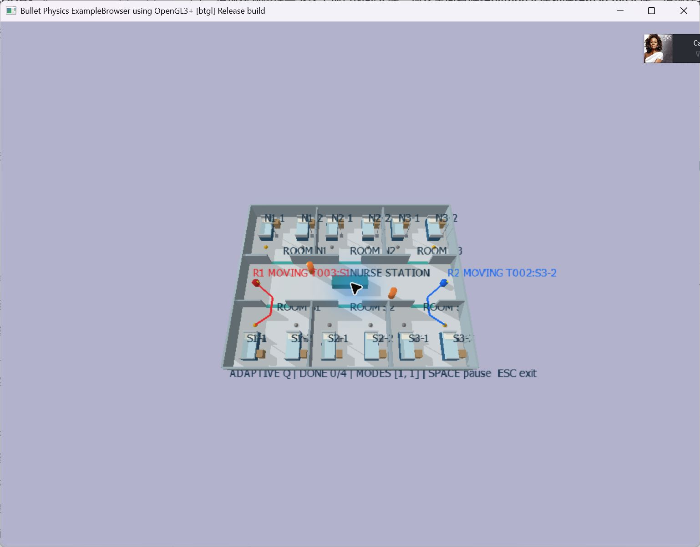
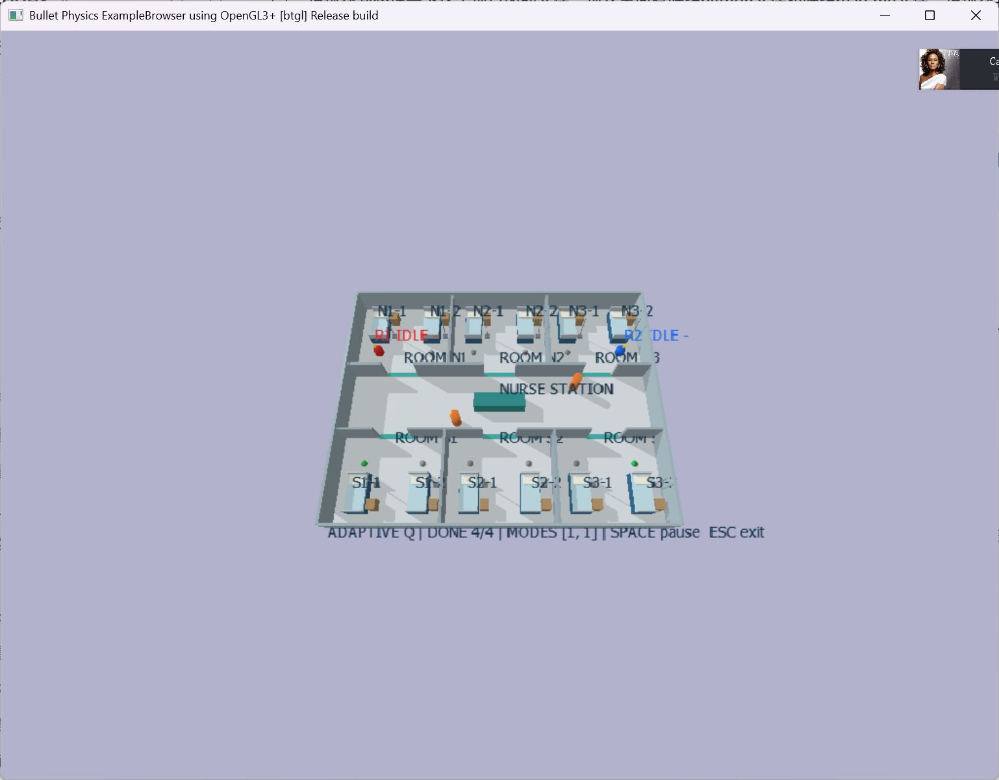
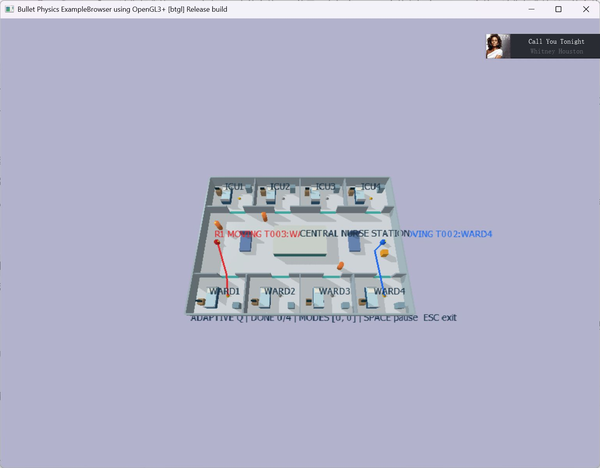
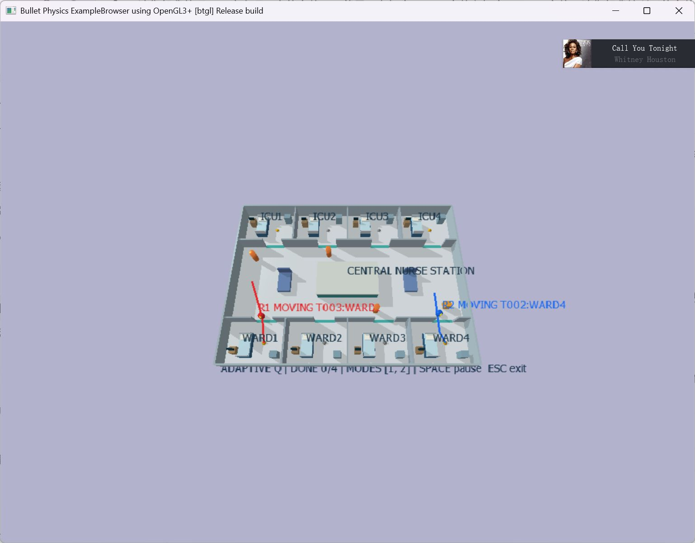
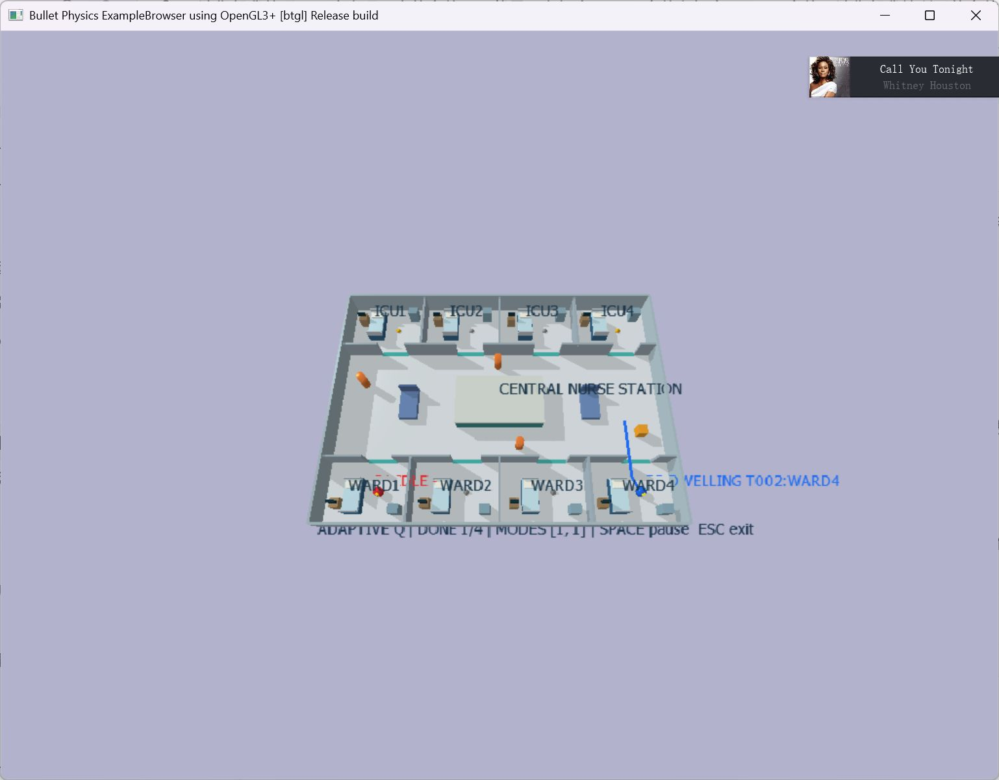
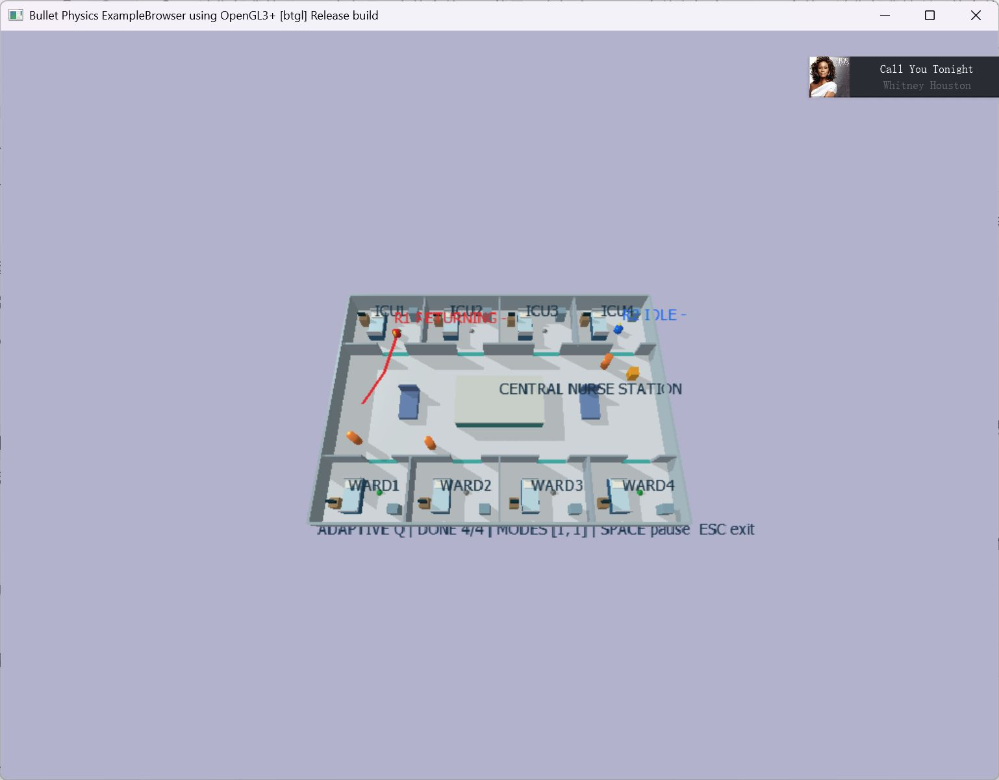

# 运行过程重要截图

本目录保存项目运行过程中值得长期保留的截图，用于说明功能、记录关键现象，以及后续汇报展示。每加入一张截图，都在本文件登记它的意义，让别人不用重新运行程序也能理解画面。

## 建议保存哪些画面

- 病区全景：说明房间、床位、机器人和动态人员的分布。
- 任务分配与执行：展示两台机器人领取任务、分别前往床位的过程。
- 避障与重规划：记录遇到人员或临时障碍后的等待、绕行和恢复。
- 任务完成：展示完成状态，并关联对应运行报告。
- 问题现场：记录卡住、超时或异常现象，便于分析和对比修复效果。
- 后续通信功能：实现 MQTT 后，记录指令下发、任务接收和结果回传。

临时截图仍可放在 `outputs/`；选定的重要截图放到这里。已有模型评估图继续保留在对应 `artifacts/` 实验目录，需要展示时可在下方记录中链接原图。

## 保存和命名方法

1. 在运行到关键位置时截取画面，保存为 PNG 或 JPG。
2. 使用“日期_功能_场景_序号_内容”的文件名，例如 `20261025_adaptive_corridor_01_obstacle_wait.jpg`。这只是命名示例，目前没有对应图片。
3. 在下方“截图索引”添加一行，然后复制“单张截图说明模板”填写细节。
4. 同一过程有多张图时，使用连续序号，并说明它们的先后关系；前后对比尽量保持相同视角。

可以使用系统截图工具捕获运行窗口。部分演示提供 `--screenshot` 参数，但它可能只保存初始场景的离屏图，不能替代运行中关键时刻的截图；具体以该入口的 `--help` 和专题指南为准。

## 本次实际运行（2026-10-25）

运行的是当前默认的 **balanced 自适应双机器人方案**（就近任务分配 + 动态规划 + Q 表模式选择），包括走廊、环形两个场景；随机种子均为 4000，动态人员开启，使用已训练的 `adaptive-q-v3` 策略。本次没有重训模型，也没有改动正式算法源码。

8 张 JPEG 均来自实际 PyBullet 图形窗口，保留原始截图，没有拼接、重绘或生成场景。为捕获关键帧，临时运行脚本在指定检查点暂停仿真步进，保存后继续；此时 UI 可能仍显示 MOVING，但仿真时间冻结。**报告的 wall_seconds 包含截图等待，不能作为运行速度指标。** 窗口右上角的音乐浮层是桌面附带内容，与项目无关。

| 场景 | 任务完成 | 仿真耗时 | 墙体/人员/机器人碰撞帧 | 报告校验 |
| --- | --- | --- | --- | --- |
| 走廊 corridor | 4/4，两台各 2 项 | 15.2 秒 | 0 / 0 / 0 | 通过 |
| 环形 ring | 4/4，两台各 2 项 | 20.95 秒 | 0 / 0 / 0 | 通过 |

这些结论只对应本次两次运行，不代表所有场景均无碰撞。本批没有单独拍到受阻等待瞬间，也没有人工放置临时障碍，不能把普通行进截图说成阻塞恢复验收。

普通运行命令（在项目根目录执行，不会自动停下来截图）：

```powershell
.\venv\Scripts\python.exe -m ward_patrol.adaptive.adaptive_patrol_demo --scenario corridor --controller balanced --seed 4000 --report outputs/demo_outputs/corridor_capture_replay.json
.\venv\Scripts\python.exe -m ward_patrol.adaptive.adaptive_patrol_demo --scenario ring --controller balanced --seed 4000 --report outputs/demo_outputs/ring_capture_replay.json
```

本次临时截图脚本位于 `outputs/capture_patrol_session.py`，它调用相同的 `run()`，只在截图检查点等待。它需要配合截图控制文件推进，不适合当作普通演示入口。

随截图长期保存的证据：

- [capture_manifest.json](capture_manifest.json)：图片文件名、实际保存时间（UTC）、对应仿真时间及图片 SHA256。
- [run_records.json](run_records.json)：两次完整运行报告（含任务、事件、轨迹和碰撞统计）及八个检查点的任务/机器人状态。
- 查看时先按下面索引浏览，再看逐张说明。红色为 R1，蓝色为 R2；DWELLING 表示床旁停留，IDLE 表示暂时空闲，RETURNING 表示返回途中。

## 截图索引

| 序号 | 截图 | 仿真时间 | 关键意义 |
| --- | --- | --- | --- |
| 01 | [走廊病区：初始布局与就近任务分配](20261025_adaptive_corridor_01_initial.jpg) | 0.000 秒 | 初始布局与就近任务分配 |
| 02 | [走廊病区：两台机器人同时穿门巡查](20261025_adaptive_corridor_02_patrolling.jpg) | 4.017 秒 | 两台机器人同时穿门巡查 |
| 03 | [走廊病区：首批两项任务完成](20261025_adaptive_corridor_03_first_completed.jpg) | 5.800 秒 | 首批两项任务完成 |
| 04 | [走廊病区：四项任务全部完成](20261025_adaptive_corridor_04_complete.jpg) | 15.200 秒 | 四项任务全部完成 |
| 05 | [环形病区：不同地图上的初始任务分配](20261025_adaptive_ring_01_initial.jpg) | 0.000 秒 | 不同地图上的初始任务分配 |
| 06 | [环形病区：绕中央区域行进与规划模式选择](20261025_adaptive_ring_02_patrolling.jpg) | 4.017 秒 | 绕中央区域行进与规划模式选择 |
| 07 | [环形病区：任务完成与床旁停留的区别](20261025_adaptive_ring_03_first_completed.jpg) | 7.233 秒 | 任务完成与床旁停留的区别 |
| 08 | [环形病区：完整巡查结束](20261025_adaptive_ring_04_complete.jpg) | 20.950 秒 | 完整巡查结束 |

## 每张截图的意义

### 01：走廊病区：初始布局与就近任务分配



- **截图时间**：2026-10-25 14:24:04（北京时间）；仿真时间 0.000 秒。
- **画面内容**：画面包含上下两排病房、中央护士站、红色 R1、蓝色 R2 和橙色动态人员。两台机器人的路线分别通向左右两侧的首个床位。
- **截图意义**：展示共享队列中的任务已按当前位置分配：R1 前往 S1-1，R2 前往 S3-2，北侧的另外两项任务仍等待执行。此时还没有完成巡查。
- **状态核对**：此刻完成 0/4 项任务。R1：moving，已完成 0 项；R2：moving，已完成 0 项。
- **关联记录**：`run_records.json` 中的 `checkpoints.20261025_adaptive_corridor_01_initial.jpg` 和 `reports.corridor`。

### 02：走廊病区：两台机器人同时穿门巡查


- **截图时间**：2026-10-25 14:24:25（北京时间）；仿真时间 4.017 秒。
- **画面内容**：红蓝两台机器人从中央走廊分别进入左右下方病房；红蓝折线是规划路线，人员也已经改变位置。
- **截图意义**：展示实际运动和穿门导航，而不是只有初始场景。两台机器人正在同时执行不同任务，本截图时还未完成任何任务。
- **状态核对**：此刻完成 0/4 项任务。R1：moving，已完成 0 项；R2：moving，已完成 0 项。
- **关联记录**：`run_records.json` 中的 `checkpoints.20261025_adaptive_corridor_02_patrolling.jpg` 和 `reports.corridor`。

### 03：走廊病区：首批两项任务完成


- **截图时间**：2026-10-25 14:24:43（北京时间）；仿真时间 5.800 秒。
- **画面内容**：底部显示 DONE 2/4，R1 和 R2 暂时显示 IDLE，分别位于南侧两端的床位巡检点。
- **截图意义**：S1-1 与 S3-2 已在同一仿真步完成。这一瞬间的 IDLE 表示刚完成任务、等待下一次调度，不代表程序卡住；继续运行后会领取北侧剩余任务。
- **状态核对**：此刻完成 2/4 项任务。R1：idle，已完成 1 项；R2：idle，已完成 1 项。
- **关联记录**：`run_records.json` 中的 `checkpoints.20261025_adaptive_corridor_03_first_completed.jpg` 和 `reports.corridor`。

### 04：走廊病区：四项任务全部完成



- **截图时间**：2026-10-25 14:25:08（北京时间）；仿真时间 15.200 秒。
- **画面内容**：底部显示 DONE 4/4，两台机器人已到达北侧两端，状态为 IDLE。
- **截图意义**：完整展示从任务分配到两轮巡查结束的结果。R1 完成 S1-1、N1-1，R2 完成 S3-2、N3-2；完成状态同时由运行报告和校验器确认。
- **状态核对**：此刻完成 4/4 项任务。R1：idle，已完成 2 项；R2：idle，已完成 2 项。
- **关联记录**：`run_records.json` 中的 `checkpoints.20261025_adaptive_corridor_04_complete.jpg` 和 `reports.corridor`。

### 05：环形病区：不同地图上的初始任务分配



- **截图时间**：2026-10-25 14:25:44（北京时间）；仿真时间 0.000 秒。
- **画面内容**：中央护士站与座椅占据中间区域，上方为 ICU1—ICU4，下方为 WARD1—WARD4；红蓝机器人分别从左右出发，场内还有动态人员和推车。
- **截图意义**：展示项目的第二种病区布局，并复用同一套自适应控制与就近调度。R1 先前往 WARD1，R2 先前往 WARD4，随后再执行 ICU 床位任务。
- **状态核对**：此刻完成 0/4 项任务。R1：moving，已完成 0 项；R2：moving，已完成 0 项。
- **关联记录**：`run_records.json` 中的 `checkpoints.20261025_adaptive_ring_01_initial.jpg` 和 `reports.ring`。

### 06：环形病区：绕中央区域行进与规划模式选择



- **截图时间**：2026-10-25 14:26:03（北京时间）；仿真时间 4.017 秒。
- **画面内容**：两台机器人分别沿中央区域两侧向下方病房移动，底部显示 MODES [1,2]。
- **截图意义**：显示同一时刻两台机器人可选择不同规划模式：本项目编号 1 为 cruise，2 为 detour。模式名不等于已证明发生了某种避障行为；这张图展示模式选择和路径跟随，效果还需看轨迹和对照评估。
- **状态核对**：此刻完成 0/4 项任务。R1：moving，已完成 0 项；R2：moving，已完成 0 项。
- **关联记录**：`run_records.json` 中的 `checkpoints.20261025_adaptive_ring_02_patrolling.jpg` 和 `reports.ring`。

### 07：环形病区：任务完成与床旁停留的区别



- **截图时间**：2026-10-25 14:26:27（北京时间）；仿真时间 7.233 秒。
- **画面内容**：底部显示 DONE 1/4，左侧 R1 为 IDLE，右侧 R2 为 DWELLING。
- **截图意义**：R1 的 WARD1 已完成；R2 已到达 WARD4，但仍在执行床旁停留，因此任务尚未记为完成。此处说明“到达床位”和“完成任务”是两个不同阶段。
- **状态核对**：此刻完成 1/4 项任务。R1：idle，已完成 1 项；R2：dwelling，已完成 0 项。
- **关联记录**：`run_records.json` 中的 `checkpoints.20261025_adaptive_ring_03_first_completed.jpg` 和 `reports.ring`。

### 08：环形病区：完整巡查结束



- **截图时间**：2026-10-25 14:27:08（北京时间）；仿真时间 20.950 秒。
- **画面内容**：底部显示 DONE 4/4，R2 位于 ICU4 附近为 IDLE；R1 显示 RETURNING 并保留返回路线。
- **截图意义**：WARD1、WARD4、ICU1、ICU4 已全部完成，两台各完成两项。R1 的 RETURNING 不表示有未完成巡查：项目以全部床位任务完成为结束条件，不要求两台都返回起点。
- **状态核对**：此刻完成 4/4 项任务。R1：returning，已完成 2 项；R2：idle，已完成 2 项。
- **关联记录**：`run_records.json` 中的 `checkpoints.20261025_adaptive_ring_04_complete.jpg` 和 `reports.ring`。

## 单张截图说明模板

每张图复制以下模板到本文件末尾，替换占位内容。索引中写一句话概括，这里写清楚细节。

```markdown
### 01：截图标题


- **截图时间**：实际日期和时间；如有仿真时间，也单独注明。
- **运行功能**：基础仿真 / 自适应规划 / 单机器人 PPO / 双机器人 PPO / 其他。
- **场景与条件**：走廊或环形、控制器、随机种子、目标床位、是否有动态人员。
- **运行命令**：从项目根目录执行的完整命令。
- **画面内容**：机器人在哪里、正在做什么、关键障碍或状态显示在哪里。
- **截图意义**：为什么保存这张图，它说明了哪个功能或问题。
- **关联证据**：报告、日志或前后截图的相对路径，例如 ../outputs/实验名/report.json。
- **结果与备注**：观察到的结果、待解决问题，以及需要结合日志才能确认的内容。
```

描述以实际观察为准。例如，静态截图可以展示机器人所处的位置，但“整轮无碰撞”“任务全部完成”还应结合报告或测试记录说明。

项目整体结构和运行方法见 [根目录 README](../README.md)。
